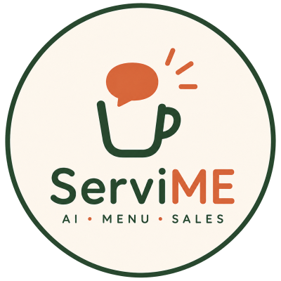
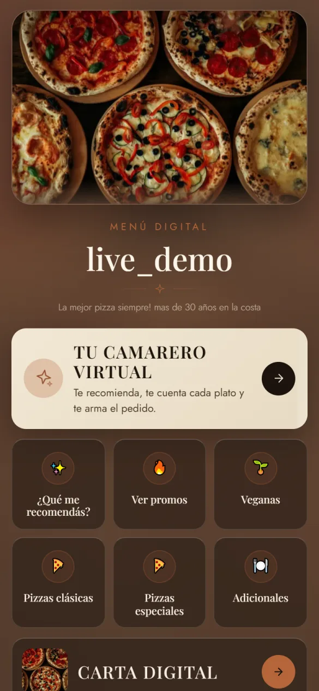
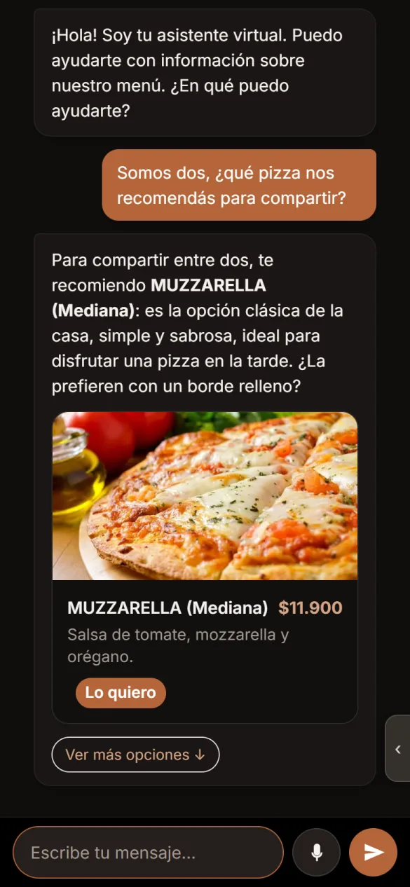
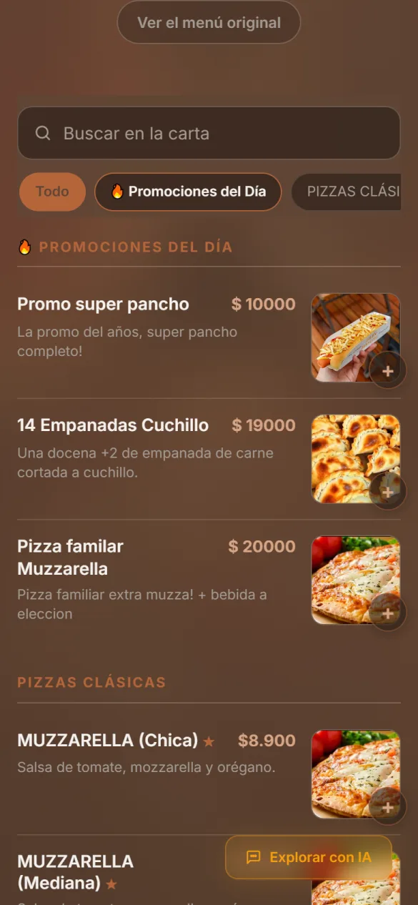
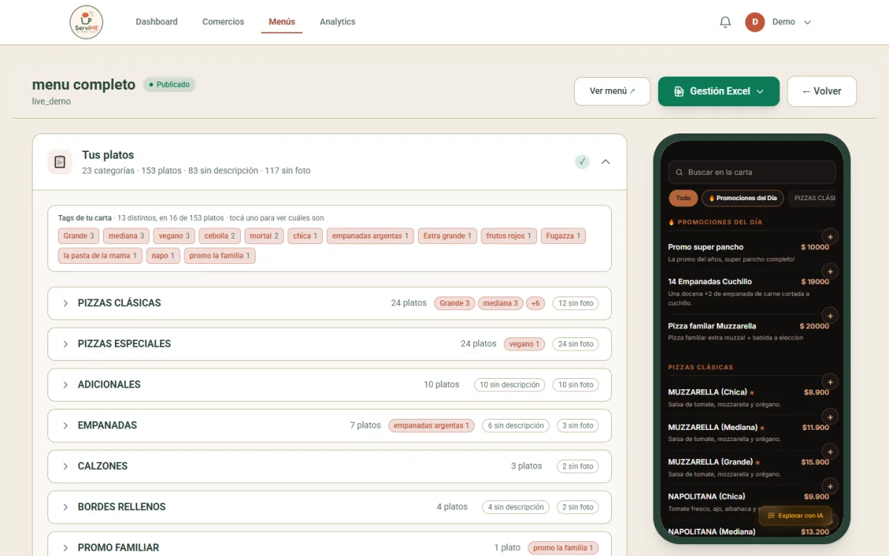
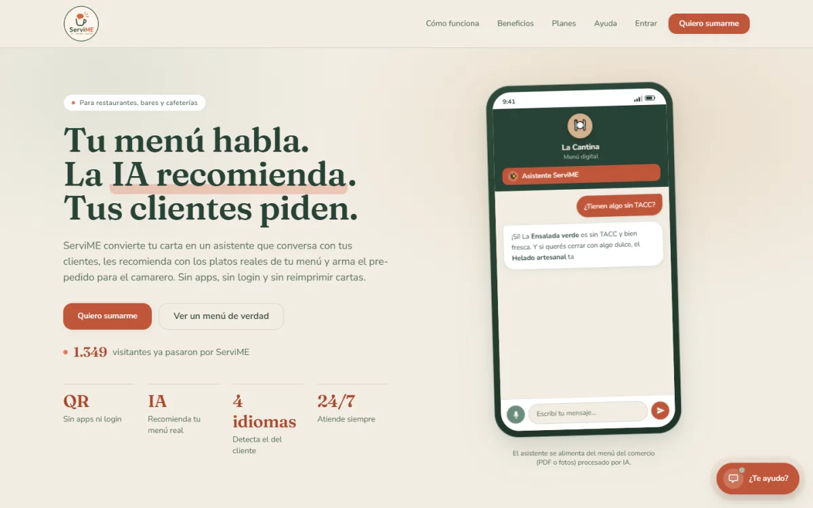
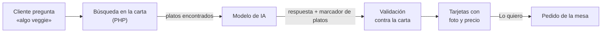

<div align="center">



# ServiME

**Menús digitales con QR y un asistente con IA para restaurantes y bares.**

El comercio sube su carta, la IA la convierte en platos editables y el cliente,<br>
desde la mesa, ve la carta, le pregunta al asistente qué pedir y arma el pedido.

<p>
  
  
  
  
  
  
</p>

**[Ver la demo en vivo →](https://servime.net/menu/live-demo)** &nbsp;·&nbsp; [servime.net](https://servime.net)

<br>

<table>
  <tr>
    <td align="center"><br><sub><b>Portada</b><br>colores sacados de la foto del local</sub></td>
    <td align="center"><br><sub><b>Asistente con IA</b><br>recomienda de la carta real</sub></td>
    <td align="center"><br><sub><b>Carta</b><br>buscador, categorías y pedido</sub></td>
  </tr>
</table>

<sub>Capturas del <a href="https://servime.net/menu/live-demo">menú de demostración</a>, tomadas en tamaño de celular.</sub>

</div>

---

## ✨ Qué hace

### 🍽️ Para el cliente en la mesa
- **Carta** con fotos, buscador que tolera errores de tipeo y filtros por etiqueta (veggie, sin TACC…).
- **Asistente con IA** que recomienda platos de la carta real y los muestra como tarjetas para sumar al pedido.
- **Notas de voz**: mantener apretado el micrófono, hablar y soltar.
- **Pedido por mesa**: el QR identifica la mesa y el pedido le llega al local.
- Guía de uso la primera vez y varios idiomas.

### 🏪 Para el comercio
- **Carga de la carta desde PDF o fotos**: la IA la lee y la convierte en categorías, platos y precios editables.
- **Editor** de platos, precios, fotos, etiquetas, promociones y platos estrella, con vista previa en vivo de cómo lo ve el cliente.
- **Portada propia**: la foto del local define la paleta de colores del menú.
- **Estadísticas**: qué preguntan los clientes, qué piden que no está en la carta, clics y pedidos.
- QR por mesa e importación/exportación por Excel.

<p align="center">
  
  <br><sub>Editor del menú: etiquetas por categoría y, a la derecha, la carta tal como la ve el cliente.</sub>
</p>

### 🛠️ Para el administrador
- **Planes editables**: cuota mensual de mensajes de IA, funciones habilitadas y modelo de IA por plan.
- Gestión de usuarios, comercios y menús.

### 🌐 Sitio público

<p align="center">
  
  <br><sub><a href="https://servime.net">servime.net</a>: la landing, con un chat de muestra y el link al menú de demostración.</sub>
</p>

---

## 🧠 Cómo responde el asistente



El modelo nunca inventa un plato ni un precio: lo que recomienda pasa por la carta real antes de llegar a la pantalla.

---

## 🔍 Decisiones de diseño

Cada una se tomó después de medir:

| Decisión | Por qué |
|---|---|
| **La búsqueda la hace PHP, no el modelo** | Un modelo chico no encuentra bien un plato suelto en un menú largo. El backend busca antes (plurales, tildes, errores de tipeo, jerga como "birra") y le pasa lo encontrado: de **6/8 a 22/22** aciertos en el banco de pruebas. |
| **La carta va primero en el prompt** | Con la carta al final, el asistente negaba platos que tenía delante. Además, lo fijo va primero para aprovechar el cacheo: **más del 90%** de los tokens de entrada salen de caché. |
| **Las tarjetas salen de un marcador, no del texto** | El modelo cierra con `[[PLATOS: …]]`, que el backend valida contra la carta. Así no hay platos inexistentes ni precios inventados. |
| **El modelo se eligió con preguntas reales** | Banco armado con consultas reales de clientes, cada caso corrido 3 veces. El modelo más caro fallaba con dietas; el elegido acierta y sale más barato gracias al caché. |
| **Límites por dispositivo, no solo por IP** | Todos los clientes de un local comparten wifi: un límite por IP los bloqueaba entre sí. Hay uno por IP como respaldo, y los robots no llegan a la IA. |
| **La lectura de cartas va por cola** | Con estados (procesando, listo, error) y reintento, para que una carta grande no corte la subida. |

---

## 🧰 Stack

| | |
|---|---|
| **Backend** | PHP 8.2 · Laravel 12 · MySQL/MariaDB · colas de Laravel |
| **Frontend** | Blade · Tailwind CSS · Alpine.js · Vite |
| **IA** | OpenAI (chat y transcripción de voz) · Google Gemini (lectura de cartas) |
| **Librerías** | Intervention Image · Laravel Excel · endroid/qr-code · smalot/pdfparser |
| **Deploy** | GitHub Actions → servidor por SSH |

---

## ✅ Calidad

- **633 tests** con PHPUnit: flujos de pedido, aislamiento entre comercios, cuotas de IA, búsqueda en la carta, límites, planes y permisos.
- Estilo con Laravel Pint (PSR-12).

```bash
php artisan test
```

---

## 🚀 Correrlo en local

<details>
<summary><b>Instalación</b></summary>

<br>

Requisitos: PHP 8.2+, Composer, Node 18+ y MySQL/MariaDB (o SQLite).

```bash
git clone https://github.com/Leohayequipo/servime.git
cd servime
composer install
npm install
cp .env.example .env
php artisan key:generate
php artisan migrate
php artisan storage:link
composer dev          # servidor + cola + logs + Vite
```

Variables a completar en `.env`:

| Variable | Para qué |
|---|---|
| `OPENAI_API_KEY` | El asistente del chat y la transcripción de voz |
| `GEMINI_API_KEY` | La lectura de cartas en PDF o foto |
| `AUTH_PASSWORD_INICIAL` | Contraseña con la que se crean las cuentas desde el admin (obligatoria) |
| `DB_*`, `MAIL_*` | Base de datos y correo |

Sin las claves de IA la app funciona igual, pero sin asistente ni lectura automática de cartas.

</details>

<details>
<summary><b>Estructura del proyecto</b></summary>

<br>

```
app/
  Http/Controllers/   Menú público, chat, carrito, panel del comercio, admin, estadísticas
  Services/           ChatbotService (prompt y búsqueda), MenuProcessorService (lectura de
                      cartas), TranscripcionService (voz), BrandThemeService (colores), …
  Models/             Comercio, Menu, Plan, ChatConversation, Comanda, Mesa, …
resources/views/      Blade: menú público, chat, editor del comercio, panel
tests/Feature/        Tests por funcionalidad
```

</details>

---

## 📌 Deuda técnica conocida

- El editor del menú (`resources/views/menus/create.blade.php`) concentra vista y JavaScript en un solo archivo grande. El próximo paso es separarlo en componentes.
- Parte del historial de commits es anterior a la convención actual (`feat(...)`, `fix(...)`).
